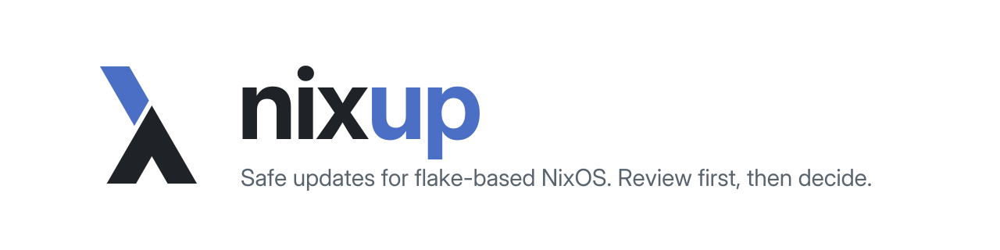

[English](README.md) | **Español**

<picture>
  <source media="(prefers-color-scheme: dark)" srcset="brand/header-dark.svg">
  
</picture>

nixup busca actualizaciones para una configuración de NixOS basada en flakes y solo las aplica cuando ya has leído qué ha cambiado upstream. Compara con su origen los inputs del flake, los paquetes que define tu flake, las entradas de `nix profile` y las apps de Flatpak. Para cada actualización pendiente te enseña los commits y las release notes que hay entre medias, y hace el build en una copia temporal antes de escribir nada. Nunca activa el sistema: ni `switch`, ni `boot`, ni `sudo`, ni demonios. Está escrito en Go, solo con la biblioteca estándar.

## Ejemplo

```text
$ nixup check --source input,package
SOURCE   NAME          CURRENT        LATEST   STATUS  ACTION
input    home-manager  4839ed6 · 20d  2c0c1f0  update  nixup lock home-manager
input    lanzaboote    v0.4.1         v1.2.0   major   pinned tag: edit flake.nix
input    nixpkgs       0bb2eed · 8d   f4a03c0  update  nixup lock nixpkgs
package  ripgrep       14.0.0         15.2.0   major   nixup pkg ripgrep

4 to update (2 likely breaking) · 1 up to date (--all to show them)
```

Con `--review` verás, después de la tabla y para cada actualización, el repositorio de origen, el número de commits con un enlace de comparación, los últimos mensajes de commit y, si la versión es un tag, las release notes entre ambas versiones.

## Instalación

Pruébalo sin instalar nada:

```bash
nix run github:Villoh/nixup -- check
```

O añádelo a tu flake y mete `inputs.nixup.packages.${system}.default` en `environment.systemPackages`:

```nix
{
  inputs.nixup = {
    url = "github:Villoh/nixup";
    inputs.nixpkgs.follows = "nixpkgs";
  };
}
```

## Primeros pasos

```bash
nixup                    # igual que `nixup check`: qué está desactualizado, solo lectura
nixup check --review     # además, commits y release notes de upstream
nixup lock               # actualiza flake.lock en una copia temporal, hace el build, pregunta y escribe
nixup lock nixpkgs       # solo ese input
nixup pkg                # actualiza tus propios paquetes uno a uno, tras revisar cada uno
nixup list               # todo lo que vigila, con las versiones actuales, sin red
nixup search ripgrep     # en tu nixpkgs, tus paquetes, tus inputs y Flatpak
```

Trabaja sobre el flake en el que estás; en cualquier otro sitio lee `NIXUP_FLAKE`, `NH_OS_FLAKE` o `NH_FLAKE` (las dos últimas son las de nh). `-C <dir>` tiene prioridad sobre ambos.

## Por qué es seguro

- `check` solo lee. No escribe nada en tu repositorio.
- `lock` ejecuta `nix flake update` y los builds de los hosts en una copia de tu árbol de trabajo. Tu `flake.lock` solo cambia si el build pasa y contestas que sí.
- `pkg` ejecuta `nix-update` fijado a la versión que acabas de revisar y luego hace el build del paquete. Si falla cualquiera de los dos pasos, el directorio del paquete vuelve a su estado del último commit.
- Ninguno de los dos toca archivos con cambios sin commitear.
- Sin terminal, todas las preguntas se responden que no, así que en ejecuciones desatendidas tienes que pasar `-y`.
- nixup nunca hace commit ni activa una generación. Probar y hacer el switch sigue siendo cosa tuya.

## Documentación

| Página | Qué cubre |
|---|---|
| [Primeros pasos](docs/es/getting-started.md) | Requisitos, formas de instalarlo, primera ejecución |
| [Comandos](docs/es/commands.md) | Todos los flags y códigos de salida |
| [Configuración](docs/es/configuration.md) | Qué flake usa, variables de entorno, token de GitHub |
| [Cómo funciona](docs/es/how-it-works.md) | Qué comprueba cada sección y qué se escribe |
| [Seguridad](docs/es/safety.md) | Las garantías y hasta dónde llegan |
| [CI](docs/es/ci.md) | Comprobaciones programadas y pull requests de actualización |
| [Limitaciones](docs/es/limitations.md) | Lo que nixup no ve |
| [Desarrollo](docs/es/development.md) | Estructura del código y tests, para quien contribuye |
| [Releases](docs/es/releases.md) | Cómo se publica una versión, para mantenedores |

Licencia MIT, ver [LICENSE](LICENSE).
